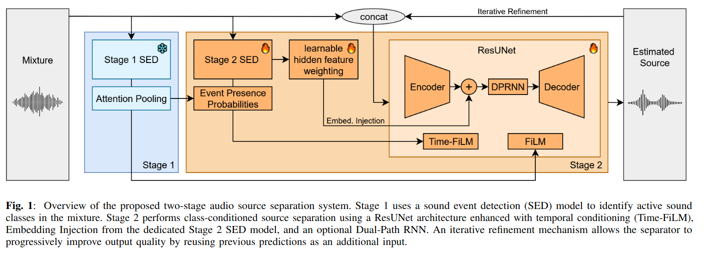
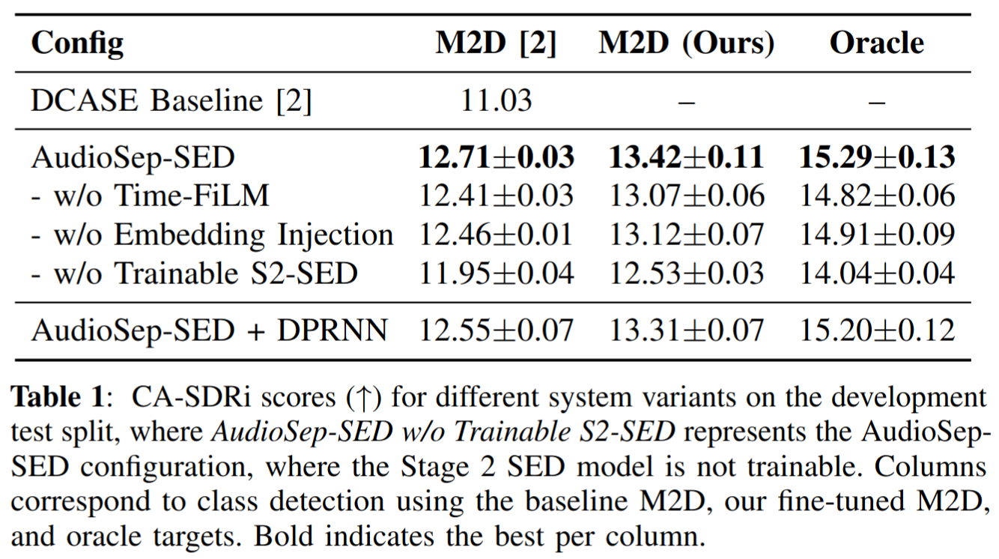
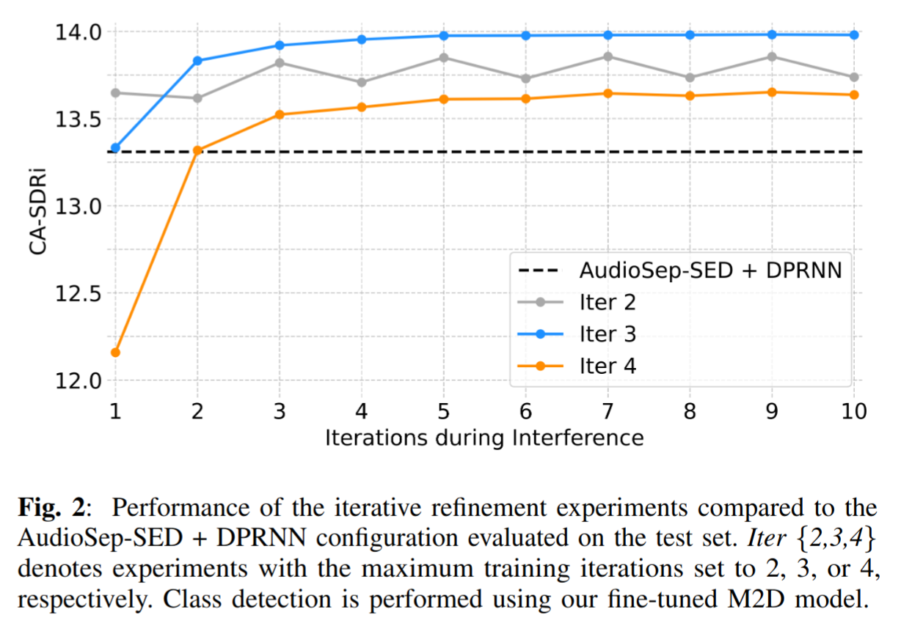

# Audio Source Separation using Sound Event Detection Models for DCASE 2025 Task 4

This repository contains the implementation for our paper accepted at the [DCASE 2025 Workshop](https://dcase.community/documents/workshop2025/proceedings/DCASE2025Workshop_Morocutti_76.pdf). 

We participated in **Task 4: Spatial Semantic Segmentation of Sound Scenes** of the DCASE 2025 challenge and achieved **2nd place** in the competition.

This code builds on the baseline codebase of DCASE 2025 Task 4: https://github.com/nttcslab/dcase2025_task4_baseline

## Overview

Our system consists of two stages:
1. **Sound Event Detection (SED)**: M2D-based tagger for detecting sound events with their onsets and offsets in mixtures
2. **Source Separation**: ResUNet-based separation model leveraging a SED model

The system uses novel mechanisms (Embedding Injection, temporal and class-wise conditioning) which enable the separator to leverage embeddings and predictions from a pre-trained sound event detection model to guide source separation.

## Method


*Figure 1: Overall architecture of our system.*

## Results


*Table 1: Quantitative results on DCASE 2025 Task 4 test set.*


*Figure 2: Performance of models using the iterative refinement mechanism with different values for the maximal number of iterations used during training.*

## Environment Setup

### Using Conda

```bash
# Clone the repository
git clone <repository-url>
cd dcase25task4

# Create conda environment
conda create -n dcase25t4 python=3.11
conda activate dcase25t4

# Install requirements; should also install PyTorch (adjust for your CUDA version)
pip install -r requirements.txt

# Install additional packages
CFLAGS='-O3 -march=native' pip install https://github.com/f0k/minimp3py/archive/master.zip
pip install datasets==3.2.0
pip install dcase-util==0.2.20
pip install git+https://github.com/fgnt/sed_scores_eval.git

# Setup wandb for logging
wandb login
```

### Installing SpatialScaper

The data generation pipeline requires SpatialScaper:

```bash
git clone https://github.com/iranroman/SpatialScaper.git
cd SpatialScaper
pip install -e .
cd ..
```

### System Requirements

SoX may be required:
```bash
sudo apt-get update && sudo apt-get install -y gcc g++ sox libsox-dev
```

## Data Setup

Look at the README.md file of the [baseline repository](https://github.com/nttcslab/dcase2025_task4_baseline) for instructions on how to download and prepare the DCASE 2025 Task 4 dataset. 
For running the code in this repository, you don't have to create the symbolic link from 'data/' to the dataset directory.

## Training

All training logs and checkpoints are saved to the `outputs/` directory.

### Training Commands

#### Sound Event Detection Model

The M2D sound event detection model we use is pre-trained on AudioSet Strong in the setup of [PretrainedSED](https://github.com/fschmid56/PretrainedSED).
When running the following command to fine-tune the M2D model, the pre-trained weights will be automatically downloaded.
To fine-tune the M2D model on the DCASE 2025 Task 4 training set, run:

```bash
python -m src.train --config config/sound_event_detection_models/m2d.yaml --wandb_name m2d
```

This model can be used as Stage 1 SED model and also as Stage 2 SED model for temporal guidance (TimeFiLM) and embedding injection in the separation models.

#### Source Separation Models

We differentiate between **two base configurations** for the AudioSep-SED source separation model:

1. **Non-Iterative Models** (`separator.yaml`):
   - Baseline model (Embedding Injection + TimeFiLM, trainable Stage 2 SED model)
   - Ablation studies (without Embedding Injection, without TimeFiLM, frozen Stage 2 SED model)
   - DPRNN variant

2. **Iterative Models** (`separator_iterative.yaml`):
   - Iterative refinement variants (maximum of 2, 3 or 4 iterations)

**Training Commands:**

**Important:** Determine the checkpoint used for the embedding injection model by using either ```embedding_injection_wandb_id``` or ```embedding_injection_checkpoint_path```. 

**1. Baseline Model** (Embedding Injection + TimeFiLM, trainable Stage 2 SED model):
```bash
python -m src.train --config config/separation_models/separator.yaml --embedding_injection_wandb_id <wandb-id-of-your-tagger-model> --wandb_name separator_baseline
```

or 

```bash
python -m src.train --config config/separation_models/separator.yaml --embedding_injection_checkpoint_path /path/to/your_tagger_model.ckpt --wandb_name separator_baseline
```

**2. Without TimeFiLM** (Embedding Injection only, trainable Stage 2 SED model):
```bash
python -m src.train --config config/separation_models/separator.yaml --embedding_injection_wandb_id <wandb-id-of-your-tagger-model> --no_time_film --wandb_name separator_no_timefilm
```

**3. Without Embedding Injection** (TimeFiLM only, trainable Stage 2 SED model):
```bash
python -m src.train --config config/separation_models/separator.yaml --embedding_injection_wandb_id <wandb-id-of-your-tagger-model> --no_embedding_injection --wandb_name separator_no_embedding_injection
```

**4. With Frozen Stage 2 SED model** (Embedding Injection + TimeFiLM, frozen Stage 2 SED model):
```bash
python -m src.train --config config/separation_models/separator.yaml --embedding_injection_wandb_id <wandb-id-of-your-tagger-model> --embedding_injection_frozen --wandb_name separator_embedding_injection_frozen
```

**5. With DPRNN** (Baseline + DPRNN):
```bash
python -m src.train --config config/separation_models/separator.yaml --embedding_injection_wandb_id <wandb-id-of-your-tagger-model> --use_dprnn --lr_dprnn 0.0005 --val_batch_size 1 --wandb_name separator_dprnn
```

**6. Iterative Refinement (2 iterations)**:
```bash
python -m src.train --config config/separation_models/separator_iterative.yaml --embedding_injection_wandb_id <wandb-id-of-your-tagger-model> --max_iterations 2 --wandb_name separator_iter_2
```

**7. Iterative Refinement (3 iterations)**:
```bash
python -m src.train --config config/separation_models/separator_iterative.yaml --embedding_injection_wandb_id <wandb-id-of-your-tagger-model> --max_iterations 3 --train_batch_size 1 --wandb_name separator_iter_3
```

**8. Iterative Refinement (4 iterations)**:
```bash
python -m src.train --config config/separation_models/separator_iterative.yaml --embedding_injection_wandb_id <wandb-id-of-your-tagger-model> --max_iterations 4 --train_batch_size 1 --wandb_name separator_iter_4
```

**Available Command-Line Arguments:**

- `--max_iterations N`: Set maximum iterations for iterative models
- `--use_time_film` / `--no_time_film`: Enable/disable TimeFiLM
- `--use_dprnn` / `--no_dprnn`: Enable/disable DPRNN
- `--embedding_injection_apply` / `--no_embedding_injection`: Enable/disable Embedding Injection
- `--embedding_injection_trainable` / `--embedding_injection_frozen`: Make Embedding Injection trainable/frozen
- `--lr_dprnn FLOAT`: Set DPRNN learning rate
- `--train_batch_size N`: Override training batch size
- `--val_batch_size N`: Override validation batch size
- `--learning_rate FLOAT`: Override learning rate

### Resuming Training

To resume training from a checkpoint (of a non-iterative model, adjust path accordingly for iterative models), use:
```bash
python -m src.train --config config/separation_models/separator.yaml --embedding_injection_wandb_id <wandb-id-of-your-tagger-model> --resume outputs/checkpoints/separator_non_iterative/<wandb_id>/last.ckpt --resume_wandb_id <wandb_id>
```

## Checkpoints

We provide pre-trained checkpoints for each training configuration. Each checkpoint corresponds to one of the training configurations described above.

Available checkpoints:
- `m2d_sed.ckpt` - Sound event detection model
- `audiosep_sed.ckpt` - AudioSep-SED model using TimeFiLM and Embedding Injection
- `audiosep_sed_no-timefilm.ckpt` - AudioSep-SED model using only Embedding Injection, no TimeFiLM
- `audiosep_sed_no-embedding-injection.ckpt` - AudioSep-SED model using only TimeFiLM, no Embedding Injection
- `audiosep_sed_s2sed-not-trainable.ckpt` - AudioSep-SED model using TimeFiLM and Embedding Injection, but Stage 2 SED model is frozen
- `audiosep_sed_dprnn.ckpt` - AudioSep-SED model using TimeFiLM, Embedding Injection and DPRNN
- `audiosep_sed_iter2.ckpt` - AudioSep-SED model using TimeFiLM, Embedding Injection, DPRNN and iterative refinement with a maximum of 2 iterations during training
- `audiosep_sed_iter3.ckpt` - AudioSep-SED model using TimeFiLM, Embedding Injection, DPRNN and iterative refinement with a maximum of 3 iterations during training
- `audiosep_sed_iter4.ckpt` - AudioSep-SED model using TimeFiLM, Embedding Injection, DPRNN and iterative refinement with a maximum of 4 iterations during training


## Evaluation

### SED Model Stages

Our system uses **two different SED models** with distinct roles:

#### **Stage 1 SED Model (Label Prediction):**
- **Purpose**: Predicts sound event labels
- **Configuration**: `evaluation_tagger_model` in YAML files of the separator
- **During training of separation model**: Set to the baseline M2D (`checkpoint/m2dat.ckpt`) for consistent evaluation on the validation set
- **During testing of separation model**: Can be set to any trained tagger model using `tagger_wandb_id` or `tagger_checkpoint_path` for evaluation of the final system on the test set

#### **Stage 2 SED Model (used for embedding injection and temporal and class-wise conditioning for separation):**
- **Purpose**: Integrated in Stage 2 of the system; provides embeddings and predictions for Embedding Injection and TimeFiLM / FiLM conditioning
- **Configuration**: `embedding_injection.tagger_model` in YAML files
- **Training**: Fine-tuned together with the separator (if `trainable: true`)
- **Integration**: Injected into separator architecture for enhanced performance


### Evaluate Models

#### **Testing Tagger Models:**
```bash
python -m src.test --config config/test_tagger.yaml --tagger_wandb_id <wandb-id-of-your-tagger-model>
```

or 

```bash
python -m src.test --config config/test_tagger.yaml --tagger_checkpoint_path /path/to/checkpoint_of_tagger_model.ckpt
```

#### **Testing Separator Models:**

For testing the separation model with the **baseline M2D tagger**:  

```bash
python -m src.test --config config/test_separator_with_baseline_tagger.yaml --separator_checkpoint_path path/to/separator_checkpoint.ckpt
```

For testing the separation model with a **fine-tuned version of our pretrained M2D SED model**: 

```bash
python -m src.test --config config/test_separator_with_tagger.yaml --tagger_wandb_id <wandb-id-of-your-tagger-model> --separator_checkpoint_path path/to/separator_checkpoint.ckpt
```

or 

```bash
python -m src.test --config config/test_separator_with_tagger.yaml --tagger_checkpoint_path /path/to/checkpoint_of_tagger_model.ckpt --separator_checkpoint_path path/to/separator_checkpoint.ckpt
```

For testing an iterative version of the separation model with a **fine-tuned version of our pretrained M2D SED model**: 

```bash
python -m src.test --config config/test_separator_with_tagger.yaml --tagger_checkpoint_path /path/to/checkpoint_of_tagger_model.ckpt --separator_checkpoint_path path/to/separator_checkpoint.ckpt --sep_multiple_iter --max_iterations 3
```

## Citation

If you use this code, please cite our paper:

```bibtex
@inproceedings{Morocutti2025,
    author = "Morocutti, Tobias and Greif, Jonathan and Primus, Paul and Schmid, Florian and Widmer, Gerhard",
    title = "On Temporal Guidance and Iterative Refinement in Audio Source Separation",
    booktitle = "Proceedings of the 10th Workshop on Detection and Classification of Acoustic Scenes and Events (DCASE 2025)",
    address = "Barcelona, Spain",
    month = "October",
    year = "2025",
}
```